# Recall

Your iMessage history as a private archive on your Mac. Search it, chart it, ask it questions, and replay how your conversations started.

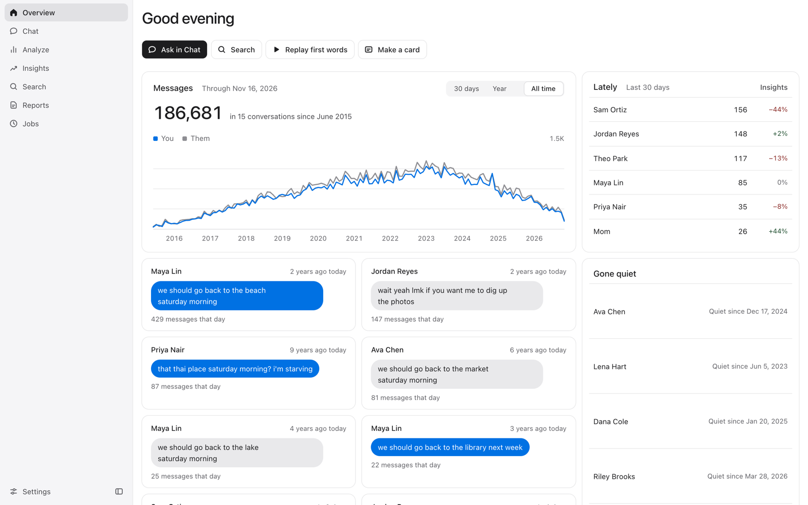

Recall reads the Messages database of your Mac into its own archive. Everything runs on your Mac: the archive, the search, the charts and the app. The optional AI features use your own API key. They send only the excerpts that a question needs, and only when you ask.

> Every name, number and message in these screenshots is invented. They come from a generated archive, not from a real one.

## What it does

### Overview

A greeting, then your messages over time (the last 30 days, the last year or all time), the people you have talked with most lately, moments from this day in earlier years, and the conversations that have gone quiet. A moment opens the whole day of that conversation.

### Insights

Count the whole archive with one question: words, a conversation, who sent it, attachments and dates. The answer comes as figures, a chart of you and them, your habits (how fast each side replies, who starts, the longest streak, late nights) and a map of the hours of the week.

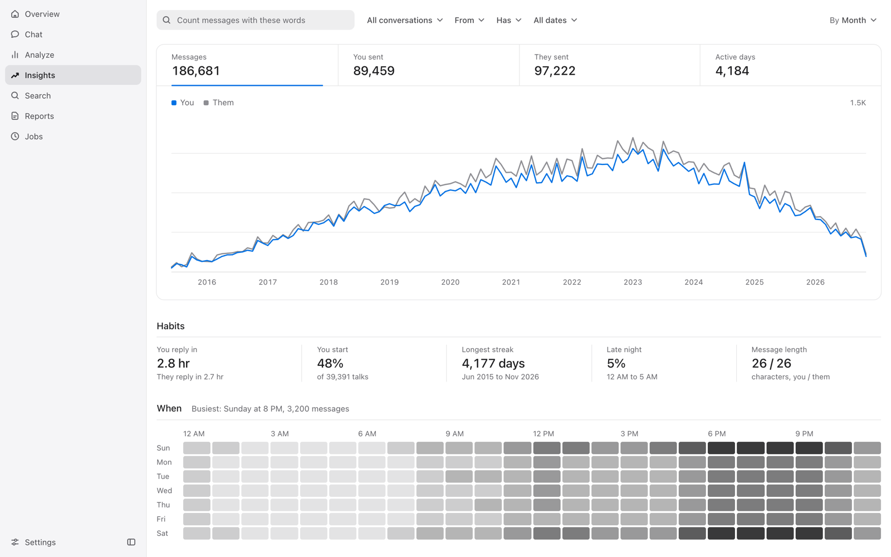

### Search

Find any message by its words, with the same filters. A result opens its day beside the list, so you see the message in its conversation.

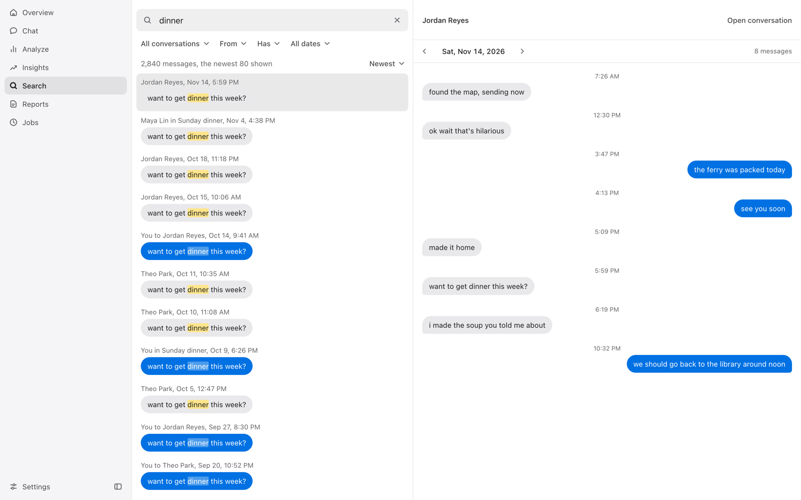

### Chat

Ask a question about your messages in plain words: "When did we first plan the trip?" A model searches, reads and counts in the archive until it can answer, and the answer cites the messages it used. Names that you have not saved are masked before anything leaves your Mac.

### Share cards

Make a picture of a moment: an anniversary, a busy day from years ago, or you and one person over the years. Each card stands on one of Recall's pixel scenes. A quoted message stays off the card until you tick the box.

<p>
  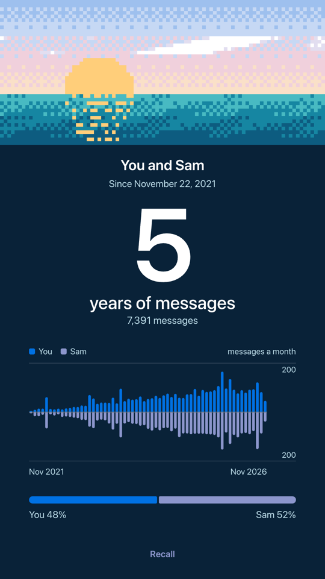
  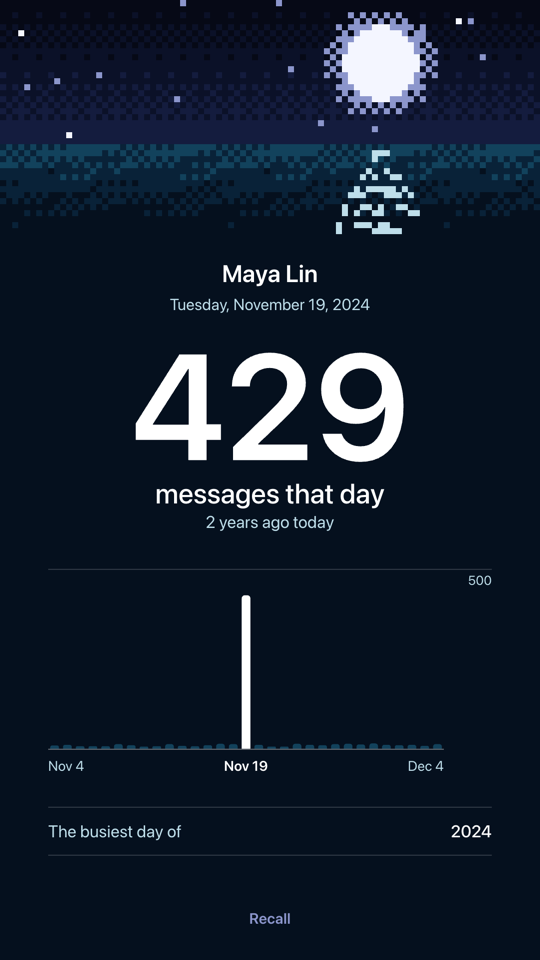
  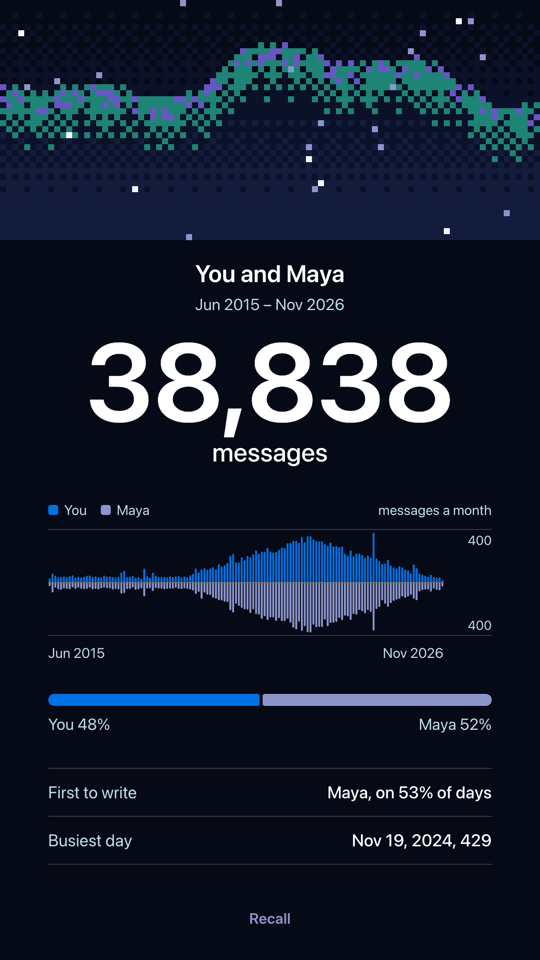
</p>

### Replay first words

The first message you exchanged with each of the people you write to most, one person at a time, arriving the way a message does.

<p>
  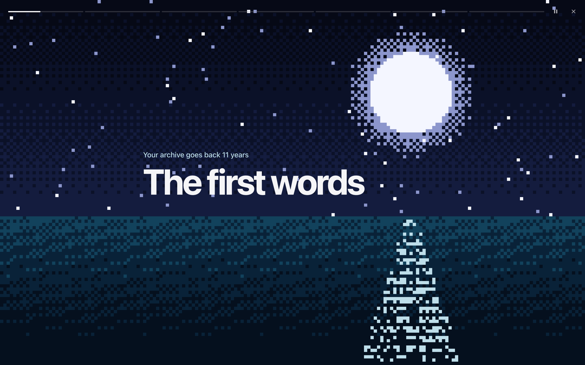
  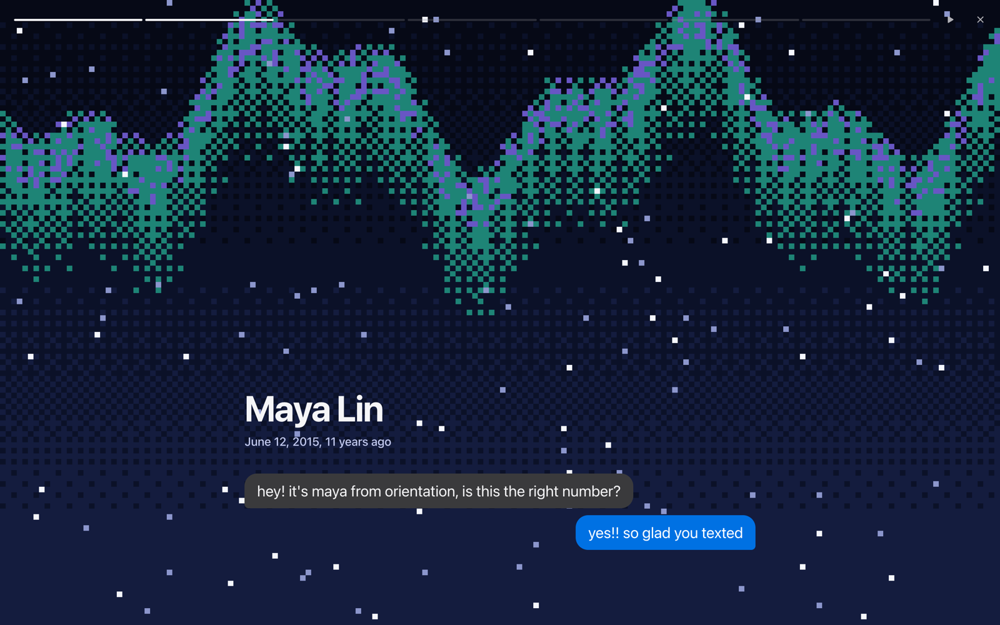
</p>

### Themes

Graphite follows the look of Messages, in light and dark. Four scene themes (Broadsheet, Shoreline, Canopy and Sky) each set their own colours and typeface, and an animated pixel picture fills the sidebar.

<p>
  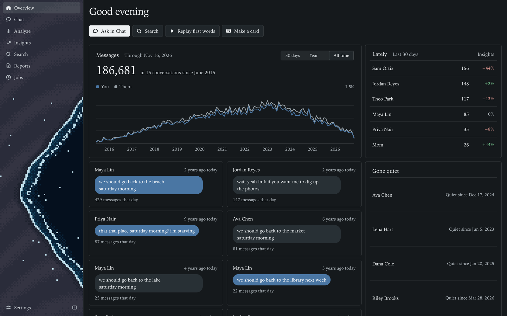
  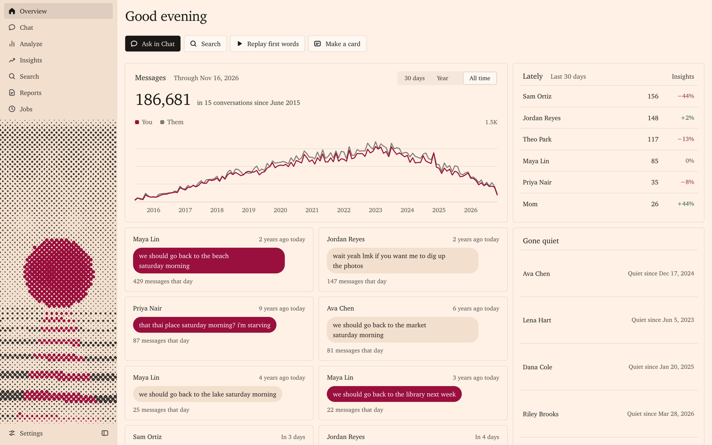
</p>

## How it works

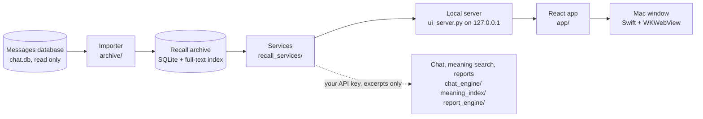

1. **Import.** The importer reads Apple's `chat.db` and mirrors it into one SQLite file, Recall's own archive. It decodes the `attributedBody` blobs that newer versions of macOS use for message text. It keeps Apple's message ids, so a second import updates the archive in place. Tapbacks are stored as reactions, not as messages.
2. **Read.** Search uses an SQLite FTS5 index. The figures, habits, days and moments are SQL over the archive, in the services package. Each service returns the JSON of one route of the local server.
3. **Show.** The local server listens only on `127.0.0.1`. The React app talks to it, and a small Swift app shows it in a native Mac window.
4. **Ask (optional).** Chat gives a model tools to search, read and count the archive, and checks each citation against the messages. Meaning search finds messages by what they mean, with vectors of conversation segments that are kept on disk. Reports read one conversation period by period and check every date and quote. All three use your own API key, and the setup tells you the most it can cost before it starts.

## Privacy

- Your archive, your saved names and your API key stay in files on your Mac. There is no account and no server of Recall's.
- Search, Insights, the Overview, share cards and Replay first words need no API key and send none of your messages anywhere.
- Chat, meaning search and reports send only the excerpts that a question needs, and only when you ask. Names that you have not saved are masked first.
- Requests to the model provider are made with storage turned off.
- The test suite blocks every network connection and runs on invented data only.

## Built with

| Part | Stack |
|---|---|
| App | React 19, TypeScript, Vite; plain CSS with cascade layers and container queries; hand-drawn SVG charts and canvas share cards |
| Mac window | Swift and WKWebView |
| Server and data | Python 3, SQLite (FTS5), pandas |
| AI | An agent loop with tools and citations, embeddings for meaning search, map-reduce reports with a cache |
| Tests | pytest (about 7,800 tests) and Node's test runner (about 600 tests) |

## Run it

You need macOS, Python 3 and Node. Recall reads `~/Library/Messages/chat.db`, so the app asks for Full Disk Access the first time you import.

```bash
python -m venv venv && source venv/bin/activate
pip install -r requirements.txt
```

Build the Mac app and open it:

```bash
scripts/build_macos_app.sh
```

```bash
open saves/Recall.app
```

The first run guides you through access, the first import and, if you want them, the AI features. Add an API key in Settings, under Archive.

### Develop

Run the local server, then the app with hot reload:

```bash
venv/bin/python ui_server.py
```

```bash
cd app && npm install && npm run dev
```

Run the checks:

```bash
venv/bin/python -m pytest -q
```

```bash
cd app && npx tsc -b && npx eslint . --quiet && npm test
```

## Project layout

| Folder | What it holds |
|---|---|
| `app/` | The React app |
| `macos/` | The Swift window |
| `ui_server.py` | The local HTTP server |
| `archive/` | The importer and the query API of the archive |
| `recall_services/` | One function for each route that reads the archive |
| `chat_engine/` | Chat: the agent, its tools, citations and masking |
| `meaning_index/` | Search by meaning |
| `report_engine/` | Reports on one conversation |
| `tests/` | Tests and the invented archives they run on |
| `CONTRACTS.md` | The rules that hold across files |

## License

MIT
